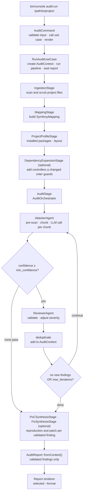
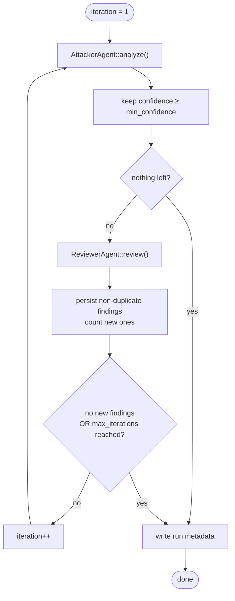

# Architecture

How the auditor is built: its layers, the data flow, the attacker/reviewer loop and where to plug in your own code.

## Table of Contents

- [Layer Overview](#layer-overview)
  - [The framework-specific boundary](#the-framework-specific-boundary)
- [Data Flow](#data-flow)
- [Domain Layer](#domain-layer)
  - [`AuditContext`](#auditcontext-mutable-pipeline-accumulator)
  - [`AuditReport`](#auditreport-immutable-final-snapshot)
  - [`Vulnerability`](#vulnerability-immutable-copy-on-write-mutations)
  - [`VulnerabilitySeverity`](#vulnerabilityseverity-backed-enum)
  - [`VulnerabilityType`](#vulnerabilitytype-backed-enum-with-owasp-and-cwe-references)
  - [`ProjectFile`](#projectfile-immutable-scanned-file)
  - [`SymfonyMapping`](#symfonymapping-immutable-project-structure-snapshot)
  - [Ports](#ports)
- [Application Layer](#application-layer)
  - [`RunAuditUseCase`](#runauditusecase)
  - [Stages](#stages)
  - [`AuditOrchestrator`](#auditorchestrator)
  - [`AttackerAgent`](#attackeragent)
  - [`ReviewerAgent`](#revieweragent)
  - [`VulnerabilityFactory`](#vulnerabilityfactory)
- [Infrastructure Layer](#infrastructure-layer)
  - [`LLMClientInterface`](#llmclientinterface)
  - [`SymfonyAiLLMClient`](#symfonyaillmclient)
  - [`LLMResponse`](#llmresponse)
  - [`ProjectFileScanner`](#projectfilescanner)
  - [Prompt builders](#prompt-builders)
  - [Report renderers](#report-renderers)
  - [Other adapters](#other-adapters)
- [Bundle Wiring](#bundle-wiring)
- [Commands](#commands)
- [Extension Points](#extension-points)

> See also: [Configuration](configuration.md) · [Extending](extending.md) · [FAQ](faq.md) · [Troubleshooting](troubleshooting.md)

## Layer Overview

The code follows strict Domain-Driven Design layering under `src/Audit/`. Dependencies point inward: `Command → Application → Domain ← Infrastructure`. Infrastructure implements the Domain ports and never leaks into Domain or Application. Deptrac enforces these rules (`deptrac.yaml`).

```text
src/
├── Audit/
│   ├── Domain/            # Pure PHP: no framework, no I/O
│   │   ├── Configuration/ # Typed configuration value objects
│   │   ├── Model/         # Value objects and enums (Vulnerability, AuditReport, SymfonyMapping, …)
│   │   ├── Exception/     # Domain exceptions
│   │   ├── Pipeline/      # PipelineInterface, StageInterface, coverage recorder ports
│   │   └── Port/          # Ports the other layers implement (LLM client, scanner, caches, …) + Tool/
│   ├── Application/       # Orchestration: no I/O, depends only on Domain
│   │   ├── UseCase/       # RunAuditUseCase, EstimateAuditCostUseCase
│   │   ├── Scan/          # Narrows the scan to the --path values
│   │   ├── Pipeline/      # AuditPipeline and its stages
│   │   ├── Agent/         # AuditOrchestrator, AttackerAgent, ReviewerAgent, chunking
│   │   ├── Budget/        # BudgetTracker, CostCalculator
│   │   └── Telemetry/     # TokenUsageRecorder
│   └── Infrastructure/    # Adapters that implement the ports
│       ├── LLM/           # SymfonyAiLLMClient: retries, rate limiting, token estimation
│       ├── FileSystem/    # ProjectFileScanner, secret scrubbing
│       ├── Scan/          # Static pre-scan, code slicing, Symfony source and YAML parsers
│       ├── Prompt/        # Attacker and reviewer prompt builders, attack-surface skills
│       ├── Cache/         # Attacker and reviewer caches
│       ├── Advisory/      # composer audit advisory lookups
│       ├── Pricing/       # Per-model prices from the models.dev catalog
│       ├── Progress/      # Progress reporters
│       ├── Tool/          # Tools the model calls (read_file, grep, record_vulnerability, …)
│       ├── Report/        # One renderer per output format
│       ├── Diff/          # git diff for --since
│       ├── Config/        # Configuration tree, standalone config, credential store
│       ├── Patch/         # Reads suggested fixes as unified diffs
│       ├── Ollama/        # Lists the models a local Ollama has pulled
│       └── Bridge/, SelfUpdate/  # Standalone binary: provider bridges, self-update
├── Command/               # Console commands and their collaborators
├── Standalone/            # The standalone binary's application and container
└── SymfonySecurityAuditorBundle.php
```



```mermaid
graph LR
    CMD["Command\naudit:run · audit:diff · …"]

    subgraph APP["Application"]
        UC["RunAuditUseCase"]
        PIPE["AuditPipeline + Stages"]
        AGENTS["AuditOrchestrator\nAttackerAgent · ReviewerAgent"]
    end

    subgraph DOM["Domain"]
        MODELS["AuditContext · AuditReport\nVulnerability · ProjectFile\nSymfonyMapping"]
        PORTS["Ports: LLMClientInterface · StageInterface\nProjectFileScannerInterface · caches\nscrubber · advisory · pricing · tools"]
    end

    subgraph INFRA["Infrastructure"]
        LLM["SymfonyAiLLMClient"]
        FS["ProjectFileScanner"]
        PROMPTS["Prompt builders"]
        CACHE["Attacker and reviewer caches"]
        ADVISORY["composer audit advisories"]
        TOOLS["Model tools"]
        RENDERER["Report renderers"]
    end

    CMD --> APP
    APP --> DOM
    INFRA -.->|implements| DOM
    APP -->|via interface| INFRA
```

**Namespace root**: `VinceAmstoutz\SymfonySecurityAuditor\`

### The framework-specific boundary

`deptrac.yaml` splits `Infrastructure` in two. The `SymfonyProfile` layer holds what only makes sense for a Symfony application:

- `Infrastructure/Prompt/**`: the prompt builders and skill blocks, which speak of controllers, voters, forms, Twig and Doctrine.
- The Symfony source and YAML parsers in `Infrastructure/Scan/`.
- The container-building classes in `Infrastructure/Config/`.

The rest of `Infrastructure` may not depend on `SymfonyProfile`. The audit engine, the LLM client, the caches, the renderers and the scanners thus stay reusable for a non-Symfony target. `Command`, the bundle class and `Standalone/` wire the Symfony profile in. `deptrac.yaml` lists the exact classes.

## Data Flow



The pipeline records each file's outcome in a coverage ledger (`analyzed`, `errored`, `skipped`). A run where some file could not be fully analyzed is incomplete: the report says so and `--fail-on-incomplete` exits `3`.

## Domain Layer

### `AuditContext`: mutable pipeline accumulator

The one mutable object, threaded through every stage. It holds the project path, a generated audit id (`AUDIT-` plus 8 hex characters), the files to audit, the mapping files (the full scan scope, never narrowed by `--since`), the `SymfonyMapping`, the findings keyed by id, the coverage ledger and free-form stage metadata (`setMeta()`, `getMeta()`).

### `AuditReport`: immutable final snapshot

Built once, by `AuditReport::fromContext()`, after the pipeline ends. It keeps only reviewer-validated findings, with the run's cost and coverage. Findings the baseline accepts or a muted type hides are listed as suppressed, never as findings.

`riskScore()` sums the severity scores of the findings. `riskLevel()` maps the sum:

| Score | Level    |
| ----- | -------- |
| >= 50 | CRITICAL |
| >= 30 | HIGH     |
| >= 15 | MEDIUM   |
| >= 5  | LOW      |
| < 5   | SAFE     |

A run that found no file, or analyzed none and found nothing, has no verdict: the reports give it no risk level.

### `Vulnerability`: immutable, copy-on-write mutations

All properties are `readonly`. A verdict returns a new instance (`withReviewerValidation()`, `withElevatedSeverity()`, `withCorrectedType()`).

The `id` is deterministic: `VULN-` plus 8 hex characters of a SHA-1 over the type, the file path and the start line, each hashed apart. Baselines, `audit:diff` and `audit:trend` match findings by `fingerprint()` instead (`SSA-` plus 12 hex characters over type, file path and title), so a finding that moves lines keeps its identity.

### `VulnerabilitySeverity`: backed enum

| Case     | Score | `isExploitable()` |
| -------- | ----- | ----------------- |
| CRITICAL | 10    | true              |
| HIGH     | 7     | true              |
| MEDIUM   | 5     | false             |
| LOW      | 2     | false             |
| INFO     | 0     | false             |

`score()` feeds the risk score. `isExploitable()` decides `Vulnerability::isHighRisk()`.

### `VulnerabilityType`: backed enum with OWASP and CWE references

50 cases in six categories:

| Category | Examples |
| --- | --- |
| Injection | `SQL_INJECTION`, `COMMAND_INJECTION`, `TWIG_INJECTION`, `XSS`, … |
| Broken Access Control | `BROKEN_ACCESS_CONTROL`, `MISSING_VOTER`, `MISSING_CSRF_PROTECTION`, … |
| Logic Flaw | `BUSINESS_LOGIC_FLAW`, `RACE_CONDITION`, `STATE_MACHINE_BYPASS`, … |
| Symfony-Specific | `MASS_ASSIGNMENT`, `UNSAFE_PARAMETER_BINDING`, `MISCONFIGURED_FIREWALL`, … |
| Data Exposure | `SENSITIVE_DATA_EXPOSURE`, `PATH_TRAVERSAL`, `SSRF`, `XXE`, … |
| Cryptographic | `WEAK_CRYPTOGRAPHY`, `HARDCODED_SECRET`, `INSECURE_RANDOM` |

`category()`, `owaspReference()` and `cwe()` give each case its category, its OWASP Top 10 reference and its MITRE CWE (label and URL). Every report and prompt uses them.

### `ProjectFile`: immutable scanned file

Holds a file's relative and absolute paths, its scrubbed content, its line count and its `ProjectFileType`. `ProjectFileTypeClassifier` sets the type once, from the path and the content. The type drives chunking, the pre-scan buckets and which skill blocks the attacker prompt gets. The `is*()` predicates (`isController()`, `isVoter()`, …) read it.

`archetype()` maps the type to a framework-neutral `SurfaceArchetype` (`HTTP_ENTRYPOINT`, `AUTHORIZATION_RULE`, `PERSISTENCE_QUERY`, …). Core logic switches on the archetype, so another framework can map its own file types onto it without widening the Symfony taxonomy.

### `SymfonyMapping`: immutable project structure snapshot

The deterministic map of the project's security surface. `MappingStage` builds it and the attacker prompt renders it in every chunk, so the model reasons about the whole application, not one file. It holds:

- The files grouped by role (controllers, voters, forms, …).
- The route access-control map: one `RouteAccessControl` per public controller action, with its `#[Route]`, its `#[IsGranted]` and `denyAccessUnlessGranted()` checks and the `access_control` rule that covers it. `controllersWithoutAccessCheck()` lists the routes nothing guards.
- The firewall rules.
- Voter coverage: one `VoterCapability` per voter, with the attributes and subjects its `supports()` accepts, so the model can flag an `#[IsGranted('ATTR', $subject)]` no voter backs.
- Form bindings: one `FormBinding` per form type a controller action creates, for mass-assignment and CSRF analysis.
- The `ProjectProfile`: installed packages and project layout (see [Stages](#stages)).

Each block is capped in entries and bytes because it repeats in every chunk. A cut list ends with `… and N more`.

### Ports

`Domain/Pipeline/` holds `PipelineInterface` and `StageInterface` (`process(AuditContext)` and `name()`), plus the coverage recorder ports. `Domain/Port/` holds every other seam: the LLM client, the file scanner, the secret scrubber, the caches, the advisory database, pricing, token estimation, rate limiting, progress reporting, the pre-scanner, the code slicer, the Symfony parsers, `--since` resolution and the model tools (`Port/Tool/`). Optional ports default to a null object (`NullStaticPreScanner`, `NullCodeSlicer`, …). [Versioning](versioning.md) lists the ports the BC promise covers.

## Application Layer

### `RunAuditUseCase`

The entry point. `execute()` creates the `AuditContext`, runs the pipeline and seals the `AuditReport`. It does no I/O itself. `EstimateAuditCostUseCase` estimates a run's cost without calling the model, for `--dry-run`.

### Stages

`AuditPipeline` runs the services tagged `symfony_security_auditor.pipeline_stage` in order and logs each stage's duration. The built-in stages run in this order:

1. **`IngestionStage`** scans the project, or the `--path` values, through `ProjectFileScannerInterface`. With `--since`, it keeps only the changed files to audit. It keeps the full scan scope apart as mapping files, so the mapping always sees the whole project.
2. **`MappingStage`** classifies the mapping files and builds the `SymfonyMapping`. Access control and firewalls come from `SecurityConfigParserInterface`. The default parser reads the YAML the production kernel loads, in load order, because the first matching `access_control` rule wins. It never runs PHP configuration. A route counts as covered only when its first matching rule checks roles or an `allow_if` expression. The prompt presents this coverage as read from YAML, not verified, so it never rules a finding out. A file nested too deep to parse safely is skipped and the pre-scan marks it `unmapped_access_control`.
3. **`ProjectProfileStage`** reads the packages `composer.lock` installs (the lockfile of the monorepo application every `--path` lies in, when there is one) and the project layout (CQRS, action-domain-responder, layered, bounded contexts). The attacker prompt tells the model where that layout puts the checks. It drops a skill's hunt line tagged `{requires …}` when the project does not install what the hunt needs. Without a readable lockfile, or with one that installs no Symfony kernel, every hunt stays.
4. **`DependencyExpansionStage`** runs only on a `--since` run with `audit.since_closure: direct`. It adds every controller whose `#[IsGranted]` names an attribute a changed voter supports, so a voter edit that weakens an unchanged controller is still audited.
5. **`AuditStage`** hands the context to `AuditOrchestrator`.
6. **`PoCSynthesisStage`** (`audit.poc_synthesis.enabled`) writes a reproduction for each validated finding at or above the severity floor, in `synthesized_poc`.
7. **`FixSynthesisStage`** (`audit.fix_synthesis.enabled`) writes a unified-diff patch for each such finding, in `suggested_fix`.

An answer cut short by the token limit or a content filter is never attached as a PoC or a fix.

### `AuditOrchestrator`

Runs the attacker/reviewer loop:



`audit.max_iterations` caps the loop (3 with the default profile, 1 with `fast`). `audit.min_confidence` (default `0.6`) sets the filter. From the second iteration on, the attacker gets the validated and rejected findings so far, so it looks for new issues instead of repeating them.

Two findings are duplicates when their ids match, or when file, type and line range overlap. The better one is kept: reviewer-validated first, then higher severity, then higher confidence, else the one seen first. A later verdict never lowers a severity already reported.

### `AttackerAgent`

For each run, the attacker:

1. Runs the static pre-scan (`audit.static_prescan.enabled`, on by default), whose zero-token risk markers the prompt shows the model.
2. Optionally trims large PHP files to their security-relevant lines (`audit.code_slicing.enabled`).
3. Groups files into chunks (`audit.chunking.strategy`). `feature`, the default, keeps a controller with its entity, repository, form, voter and templates. `type` uses the legacy priority window: controllers, voters, entities, repositories, forms, then the rest.
4. Sends each chunk to the model with the `SymfonyMapping`, the markers and the prior findings.

By default (`audit.structured_collection: true`), the model records each finding with a `record_vulnerability` tool call, which the provider validates against the tool's JSON schema. With the flag off, the model answers with a JSON array. With `audit.tools_enabled` (the default), the model can also call `read_file`, `grep`, `list_files` and `lookup_advisory` to follow code across files, for up to `audit.max_tool_iterations` rounds. The file tools open only the audited files unless `audit.tools_scope: scanned` opens every scanned file.

Each chunk's answer is cached through `AttackerCacheInterface` when `cache.enabled` is on. The key covers the chunk's content, the access-control part of the mapping, the prompt context and the parts of the project profile the prompt uses. A `security.yaml` edit or a new voter therefore re-analyzes the chunk. `--no-cache` bypasses the cache for one run. With `audit.attacker_max_concurrent` above 1 and a client that batches tool calls, cache misses run concurrently with the same results.

A chunk ends `errored`, out of the cache, when its answer was cut short, held an entry that could not be read as a finding or ended on a refused `record_vulnerability` call. The findings it did yield are kept and the report is incomplete. A chunk too large for the model is split in two until every part fits. A single file that still does not fit is recorded `errored`. A non-transient provider failure (authentication, unknown model) stops the run rather than produce a false SAFE.

**Escalation.** With `audit.escalation.enabled`, `EscalatingAttackerAgent` first runs a cheap model (`audit.escalation.cheap_model`) over every file. The attacker model then analyzes only the flagged files and gets the cheap findings as unverified candidates to confirm, refine or discard. A cheap finding the deep pass does not report again is dropped.

### `ReviewerAgent`

Checks each finding that passed the confidence filter against its source. A verdict accepts or rejects the finding and may adjust its severity (`adjusted_severity`) or type (`corrected_type`).

- By default (`audit.reviewer_structured_collection: true`), verdicts come in through a schema-enforced `record_review` tool call.
- `audit.reviewer_tools_enabled` gives the reviewer the attacker's tools and keeps the JSON path.
- `audit.reviewer_batch_size` reviews several findings per call. `audit.reviewer_max_concurrent` reviews them concurrently.

Only an explicit `accepted` value is a verdict. A finding the model never judged (an empty answer, no `record_review` call, a missing or unreadable `accepted`) is recorded `errored`, not rejected. The report is then incomplete and the next run reviews the finding again, unless a later iteration of the same run reaches a verdict on it.

Verdicts are cached across runs through `ReviewerCacheInterface` when `cache.enabled` is on. Every mode serves cached verdicts before calling the model. A verdict given at the tool-call limit after reading files is applied but never cached.

### `VulnerabilityFactory`

Turns each finding the model returned into a `Vulnerability`. It first repairs what it safely can: it cuts overlong text fields, swaps an inverted line range, normalizes the case of `type` and `severity` and scales a percentage `confidence` to 0-1. It then validates the entry with `symfony/validator`. An entry it cannot read is dropped and counted by `VulnerabilityDropReason` in the `Attacker agent complete` log. A chunk that lost an entry is recorded `errored` and is not cached, so the next run asks again.

## Infrastructure Layer

### `LLMClientInterface`

```php
interface LLMClientInterface
{
    public function complete(string $systemPrompt, string $userMessage): LLMResponse;

    public function completeWithTools(
        string $systemPrompt,
        string $userMessage,
        ToolRegistry $toolRegistry,
        int $maxToolIterations,
    ): LLMResponse;

    public function model(): string;
}
```

The only seam between the Application layer and LLM I/O: the agents never import a `symfony/ai` type. `BatchCapableLLMClientInterface` and `ToolBatchCapableLLMClientInterface` add concurrent calls. To write your own client, see [Extending](extending.md).

### `SymfonyAiLLMClient`

The one adapter behind `LLMClientInterface`, built on the `symfony/ai` platform. It:

- Books the token usage of every call for the budget (`audit.budget.*`) and the report's cost.
- Retries transient failures (HTTP 429, 5xx) with jittered exponential backoff, as `audit.retry.*` sets.
- Throttles calls to the windows `audit.rate_limit.*` sets and honors a provider's `Retry-After`.

Switching provider (Anthropic, OpenAI, Mistral, Ollama, …) is an `ai.yaml` change, with no code change. See [Platform Configuration](configuration.md#platform-configuration).

### `LLMResponse`

Wraps the model's answer and its token usage. `parseJson()` reads the JSON even when the model wraps it in a code fence or in prose. `isDegraded()` marks an answer cut short (token limit, content filter, tool-loop cap, no content), which is never cached or counted as a verdict.

### `ProjectFileScanner`

Walks `scan.included_paths` (by default `src/`, `config/`, `templates/`, `public/index.php` and the root `.env*` files). It reads `.php`, `.twig`, `.yaml`, `.yml` and `.xml` files, plus any file the list names directly. It respects `.gitignore` and `scan.max_file_size_kb` and returns files sorted by path, so chunks and cache keys match on every machine.

Each file goes through `SecretScrubberInterface` before its content can reach the model. Bytes that are not valid UTF-8 are rewritten as Latin-1 characters. A file the scan leaves out (too large, unreadable, a name that becomes ambiguous once repaired) shows in the coverage ledger.

### Prompt builders

`AttackerPromptBuilder` and `ReviewerPromptBuilder` are pure string builders.

The attacker prompt holds the rubrics, the `SymfonyMapping` blocks and the chunk's files. Every line of a file is prefixed with `` `NNN | ` `` so the model reports exact line numbers. Skill blocks, one per attack surface (controller, voter, form, repository, template, config, …), list what to hunt and what not to flag. `AttackerSkillRegistry` emits a block only when a file of its type is in the chunk, in attack-surface priority order. `audit.custom_skills` adds your own instructions without code.

The reviewer prompt carries a Symfony false-positive playbook (Doctrine `setParameter()`, default CSRF protection, `mapped: false`, a `Process` with a fixed argv, …) so the reviewer rejects known non-issues. A verdict holds `id`, `accepted`, `adjusted_severity`, `corrected_type`, `reviewer_notes` and `additional_attack_paths`.

### Report renderers

One class per `--format`, each implementing `ReportRendererInterface` (`format()` and `render()`): `console`, `executive`, `json`, `sarif`, `html`, `markdown`, `junit`, `github` and `github-comment`. `ReportWriter` picks the renderer whose `format()` matches. See [Output Formats Reference](configuration.md#output-formats-reference).

### Other adapters

| Folder | Purpose |
| --- | --- |
| `Cache/` | Filesystem attacker and reviewer caches under `cache.dir`, with null twins for `cache.enabled: false` |
| `Advisory/` | `lookup_advisory` answers from `composer audit` on the project's `composer.lock`, cached by lockfile hash |
| `Pricing/` | Per-model prices from the `symfony/models-dev` catalog, for the cost report and `audit.budget.max_cost_usd` |
| `Progress/` | Progress events for a terminal, plain CI output or the logger |
| `Scan/` | Regex pre-scanner, SARIF import (`scan.import_sarif`), code slicer, Symfony source and YAML parsers |
| `Diff/` | The changed files of `--since`, from `git diff` |
| `Tool/` | The tools the model calls: `read_file`, `grep`, `list_files`, `lookup_advisory`, `record_vulnerability`, `record_review` |
| `Config/` | Configuration tree, standalone config loader, per-user credential store |

## Bundle Wiring

`SymfonySecurityAuditorBundle` extends `AbstractBundle`. `configure()` defines the `symfony_security_auditor` tree (see [Bundle Configuration](configuration.md#bundle-configuration)). `loadExtension()` imports `config/services.php` and registers the LLM clients:

- `security_auditor.attacker_client` on `attacker_model`, else `model`.
- `security_auditor.reviewer_client` on `reviewer_model`, else `model`.
- `security_auditor.cheap_attacker_client` with `audit.escalation.enabled`, on `audit.escalation.cheap_model`, else the reviewer model.

`LLMClientInterface` is an alias of the attacker client. Each cache port points at its filesystem cache when `cache.enabled` is on, at its null twin otherwise. Autoconfiguration tags every `StageInterface` service `symfony_security_auditor.pipeline_stage`. The resolved settings are exposed as `symfony_security_auditor.*` container parameters.

The model names must exist on the platform `config/packages/ai.yaml` configures. The auditor needs no agent entry there.

## Commands

`audit:run` (alias `audit`) only orchestrates. `AuditCommandInput` maps the input, `RunAuditUseCase` runs the audit, `ReportWriter` renders and writes the report, `AuditPresenter` prints the messages and `AuditExitCodeResolver` picks the exit code. The [CLI Reference](configuration.md#cli-reference) lists every command and option. [Exit codes](configuration.md#exit-codes) lists what each exit code means.

The standalone binary (`src/Standalone/`) builds the same container from the user's config files instead of a Symfony application.

## Extension Points

| To | Do this |
| --- | --- |
| Add a pipeline stage | Implement `StageInterface` and register it as an autoconfigured service. Give it a negative priority (`#[AsTaggedItem(priority: -100)]`) to run after the built-in stages. |
| Switch LLM provider | Change `config/packages/ai.yaml`. No code change. |
| Use your own LLM client | Implement `LLMClientInterface` and point `security_auditor.attacker_client` and `security_auditor.reviewer_client` at it (and `security_auditor.cheap_attacker_client` with escalation). |
| Add attacker instructions | Set `audit.custom_skills`. |
| Give the model a new tool | Implement `Tool\ToolInterface` and alias `Tool\ToolRegistryFactoryInterface` to a factory whose registry adds it, for example one decorating `SymfonyToolRegistryFactory`. |
| Replace the advisory source, secret scrubber, token estimator, pricing, rate limiter, progress reporter or a Symfony parser | Implement its Domain port and alias it in `config/services.yaml`. |
| Add a report format | Add a case to `Command\OutputFormat` and a `ReportRendererInterface` class returning it from `format()`, registered in `config/services.php`. |
| Add a vulnerability type | Add a `VulnerabilityType` case and its branch in `category()`, `owaspReference()`, `owaspReferenceUrl()` and `cwe()`. Nothing else changes. |
| Add a severity level | Add a `VulnerabilitySeverity` case with `score()`, `label()` and `isExploitable()`, then update the thresholds in `AuditReport::riskLevelEnum()`. |

[Extending](extending.md) shows each one with code.
